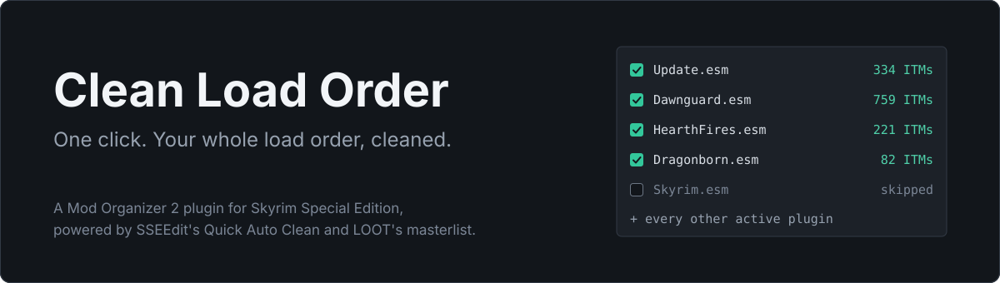
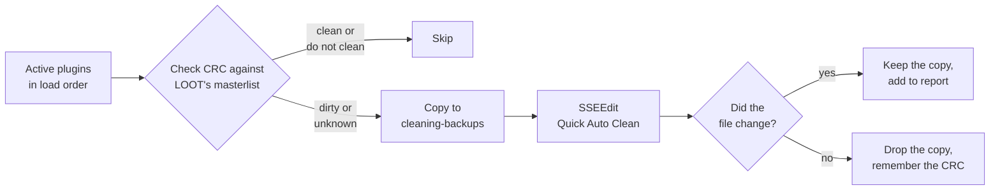

<div align="center">



<br>

**Stop cleaning plugins one at a time.**<br>
Clean Load Order runs SSEEdit's Quick Auto Clean across your active plugins, in load order, right from Mod Organizer 2.

<br>

[](https://raw.githubusercontent.com/ldallacqua/clean-load-order-mo2/main/CleanLoadOrder.py)
[](https://github.com/ModOrganizer2/modorganizer)
[](#requirements)
[](LICENSE)

[Install](#install) · [What it does](#what-it-does) · [Safety](#safety-nets) · [Good to know](#good-to-know) · [Restore](#restoring-a-plugin) · [FAQ](#faq)

</div>

<br>

## The problem

LOOT tells you which plugins hold junk. Fixing that means opening SSEEdit's Quick Auto Clean, picking one plugin, waiting, closing, and repeating. With dozens of Creation Club files and mods, that's an evening gone.

This plugin does that loop for you. Open it from the tools menu, read the list, and click **Clean**.

## What it does



- **Cleans in load order**, so each master is done before the plugins that depend on it.
- **Runs on what needs it.** That means plugins LOOT reports as dirty, plus plugins LOOT has no data on, because LOOT's list isn't complete.
- **Skips the rest:** `Skyrim.esm`, plugins LOOT knows are clean, plugins LOOT notes as "do not clean", and common generated patches (DynDOLOD, Occlusion, Synthesis, Bashed Patch).
- **Remembers its work.** A plugin that was already processed is skipped until its CRC changes, so a second run only touches what's new.
- **Works unattended.** It closes SSEEdit's donation message if it appears and terminates a run stuck for 10 minutes, so one bad plugin doesn't hold up the queue.

### From a real run

| Plugins processed | Cleaned | ITMs removed | References undeleted | Failures | Time |
|---:|---:|---:|---:|---:|---:|
| 72 | 44 | 1,691 | 255 | 0 | about 15 minutes |

Measured on Skyrim SE 1.5.97 with Anniversary Edition content, MO2 2.5.2 and SSEEdit 4.1.5f. It includes the four large official masters, which take the longest.

## Requirements

- [Mod Organizer 2](https://github.com/ModOrganizer2/modorganizer) 2.5, which ships the Python 3.12 and PyQt6 this plugin uses
- [SSEEdit](https://www.nexusmods.com/skyrimspecialedition/mods/164), added to MO2's executables
- [LOOT](https://loot.github.io/), with its masterlist updated at least once
- Skyrim Special Edition

## Install

1. Download [`CleanLoadOrder.py`](https://raw.githubusercontent.com/ldallacqua/clean-load-order-mo2/main/CleanLoadOrder.py).
2. Copy it to `<MO2 folder>/plugins/`.
3. Restart MO2.

You'll find it as **Clean Load Order** in the tools button on MO2's toolbar, and under **Tools › Tool Plugins** in the menu.

> [!TIP]
> If SSEEdit isn't in your executables, set its path under **Settings › Plugins › Clean Load Order › xedit**.

## Safety nets

Cleaning rewrites your plugins, so the plugin checks its work and stops when something looks wrong.

| Situation | What happens |
|---|---|
| Before any plugin is touched | It's copied to `cleaning-backups/<date>/`. The copy stays if the plugin changed. |
| SSEEdit opens the wrong game folder | The whole run stops. |
| A plugin disappears after cleaning | The original is restored and the run stops. |
| SSEEdit produces no log | The run stops. |
| A run takes over 10 minutes | SSEEdit is terminated, the plugin is marked as failed and the queue continues. |
| LOOT's masterlist is missing or empty | It refuses to start, because it couldn't recognize "do not clean" plugins. |
| The cleaned file lands in Overwrite | It's moved back to the mod it came from. |

> [!NOTE]
> The wrong-folder check exists for a reason. Left alone, SSEEdit finds the game through the Windows registry, which can be a different install from the one MO2 manages. That's common on downgraded setups. The plugin always passes the data folder explicitly.

## Good to know

- **Official masters are modified in place.** With a Stock Game setup, the cleaned files replace the ones in that folder. The originals are in `cleaning-backups`. If MO2 manages your real Steam folder, keep in mind that Steam may replace cleaned files when it verifies or updates the game.
- **Deleted navmeshes aren't fixed.** Quick Auto Clean doesn't touch them. The report lists the plugins that have them. LOOT will probably stop warning about those plugins, because their CRC changed, but the navmeshes are still there.
- **Unknown plugins carry some risk.** Authors sometimes keep ITMs on purpose without LOOT recording it. If a mod behaves differently after cleaning, restore its copy.
- **The SSEEdit window will steal focus,** once per plugin. It's best to leave the PC alone while it runs.
- **Some LOOT warnings can't be cleared.** LOOT's counts are tied to specific masters. On a downgraded game, a plugin can be flagged for an ITM that only exists against newer masters. SSEEdit finds nothing to remove, so the warning stays, and that's correct.
- **Not covered yet:** the donation message closer hasn't been exercised in a real run, because the message didn't appear during testing. If it stays open, click **Close** and the queue continues.

## Restoring a plugin

Every run leaves a folder at `<MO2 folder>/cleaning-backups/<date>/`:

```text
2026-11-02_21-16-55/
├── report.txt      what changed, and where each plugin lives
├── Update.esm      the original, before cleaning
├── Dawnguard.esm
└── ...
```

To undo a plugin, copy its file back to the location given in `report.txt`, then refresh MO2. Its CRC changed, so the next run will clean it again. To stop that, add its name in lowercase to `NEVER_CLEAN` at the top of the script.

## FAQ

<details>
<summary><b>Should I clean my official masters at all?</b></summary>
<br>
It's a long-running debate, and the plugin doesn't take a side beyond following LOOT: if LOOT flags them, they get cleaned. If you'd rather leave them alone, add their names in lowercase to <code>NEVER_CLEAN</code> at the top of the script.
</details>

<details>
<summary><b>Why does a plugin stay flagged after a run?</b></summary>
<br>
Check <code>report.txt</code>. If the plugin isn't listed as cleaned or failed, SSEEdit found nothing to remove with your masters. The usual reason is that LOOT's count was made against a different game version.
</details>

<details>
<summary><b>Does it work with other games?</b></summary>
<br>
Not at the moment. It only activates for Skyrim Special Edition, and it reads that game's LOOT masterlist.
</details>

<details>
<summary><b>Can I cancel a run?</b></summary>
<br>
Yes. Clicking <b>Cancel</b> lets the current plugin finish and then stops. Running it again picks up where it stopped.
</details>

## Development

The tests drive the plugin with a fake SSEEdit, so they never touch a real game. Windows only.

```bash
pip install PyQt6
python -m unittest discover tests
```

## Credits

All of the actual cleaning is done by [xEdit](https://github.com/TES5Edit/TES5Edit), and the knowledge of what's dirty comes from the [LOOT](https://loot.github.io/) team's masterlist. This plugin only automates the loop around them. Neither project is affiliated with it.

## License

[MIT](LICENSE)
